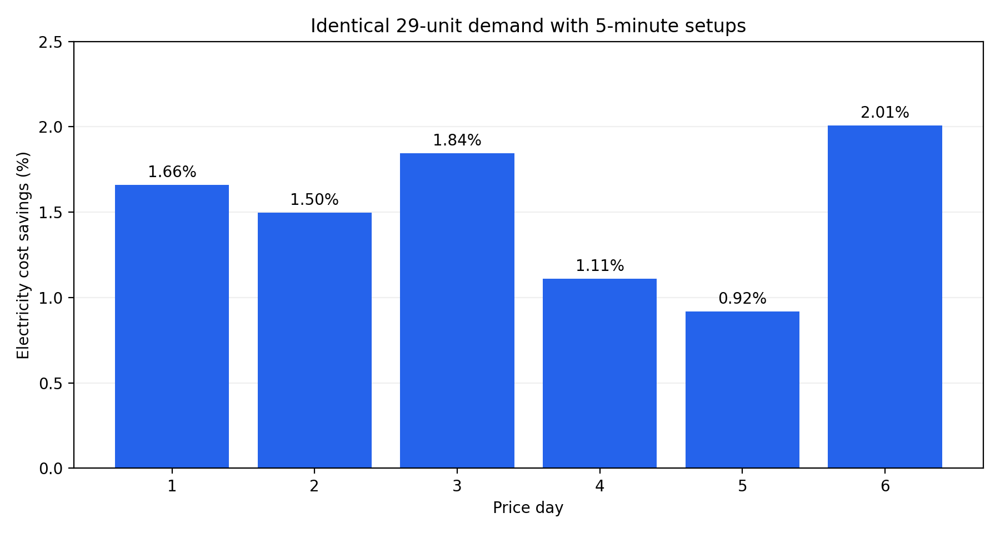
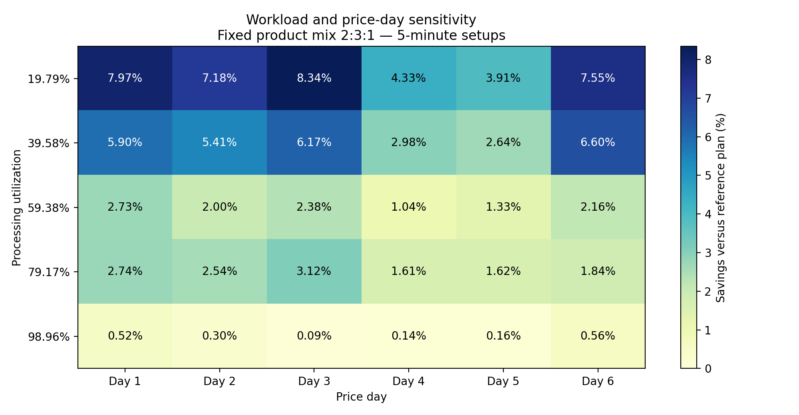
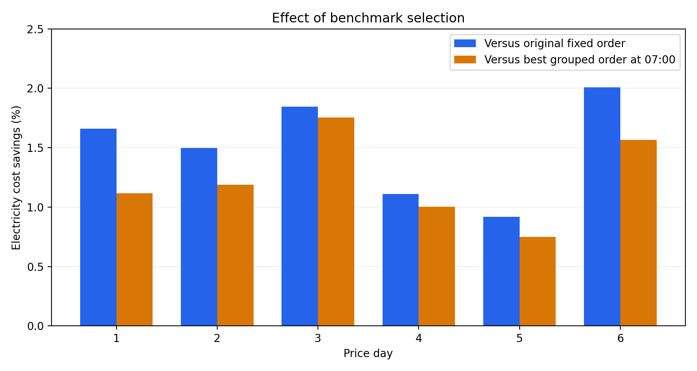

# Energy aware production planning

This independent student project investigates when production scheduling can reduce electricity costs while respecting machine capacity, non-interruptible processing and product-change setup times. It uses a documented subset of a published textile-production dataset, rather than claiming an implemented factory intervention.

The central finding is conditional: scheduling benefits depend on workload, price timing, setup assumptions and the comparison policy. Small percentage savings in this case also correspond to small absolute amounts.

## Selected system

| Input | Model choice |
| --- | --- |
| Machine | MAQ120 |
| Products | PRINTED RIBBON PES, BRAIDED ELASTIC, SMOOTH STRAP(A) |
| Original selected quantities | 10, 15, 4 production units |
| Processing time | 905 minutes |
| Processing energy | 56.655 kWh |
| Working day | 07:00 to 23:00 |
| Time resolution | 5 minutes |
| Main setup scenario | 5 minutes per product-type change |
| Price profiles | Six working days from the published dataset |

The source identifier `PRINTED RIBBON  PES` contains two spaces; the loader preserves it. These are three separate, single-task products. The model does not reorder the technological stages of a single product. Production quantities refer to the dataset's units; they should not be interpreted as confirmed individual physical pieces or as observed daily orders.

## Main results

| Comparison | Result |
| --- | --- |
| Original quantities, day 1, 5-minute setups | 3.861270 EUR reference; 3.797142 EUR optimized; 1.66% savings |
| Original quantities across six independently tested price days | 1.50% combined savings versus the original grouped order |
| Same six cases versus each day's best grouped order starting at 07:00 | 1.22% combined additional savings |
| Controlled 2:3:1 mix at 19.79% processing utilization | 6.53% combined savings across the six price profiles |
| Controlled 2:3:1 mix at 98.96% processing utilization | 0.29% combined savings |

Combined percentages use the sums of reference and optimized costs, not the unweighted mean of daily percentages. The workload study uses a different mix from the original 10:15:4 demand. Price-day repetitions are controlled scenarios, not a reconstruction of actual company daily or weekly production. Results are in EUR, not cents; for example, 0.427 EUR is 42.7 cents.

## Reproduce the results

The core model and CSV analyses need Python 3.10 or later and use only the standard library. From this project directory:

```bash
python3 -m src.run_analysis
python3 -m unittest discover -s tests -v
```

For figures and the educational notebooks, install the listed dependencies in your preferred Python environment:

```bash
python3 -m pip install -r requirements.txt
python3 -m src.run_analysis --plots
```

For a browser-only workflow, open `notebooks/03_run_project.ipynb` in Google Colab, run its cells and upload the project ZIP when prompted. It runs the same module and tests and offers the reproduced outputs as a download.

`src/run_analysis.py` regenerates six daily cases, thirty workload cases, four setup cases, the improved benchmark comparison and six independent validation cases. CSVs and a run metadata file are written to `results/`; selected input tables are written to `data/processed/`. `--plots` also creates three figures in `results/figures/`.

## Project contents

| Path | Purpose |
| --- | --- |
| `src/scheduler.py` | Exact dynamic programming solver and grouped benchmark |
| `src/data.py` | Source loading and selected product validation |
| `src/run_analysis.py` | Reproducible analysis entry point |
| `src/validation.py` | Independent exhaustive enumeration on small examples |
| `tests/` | Regression, input isolation, capacity and validation checks |
| `notebooks/01_energy_scheduling_pilot.ipynb` | Historical learning steps and schedule reconstruction |
| `notebooks/02_daily_price_comparison.ipynb` | Daily prices, sensitivity analyses, benchmark and interpretation |
| `docs/methodology.md` | State definition, decisions and model boundaries |
| `docs/data_sources.md` | Attribution, units and source quality notes |
| `results/` | Generated numeric results and figures |

The packaged notebook copies retain source code and written findings but clear execution outputs and browser-specific metadata. The core module is the reproducible calculation entry point. The educational notebooks intentionally show the earlier learning sequence; the first contains an intermediate re-upload step. Uploaded source notebooks remain separate originals.

## Interpretation and limitations

All jobs are ready at 07:00. All prices for the day are known before scheduling. Initial setup, idle electricity and setup electricity are zero. Setup durations are scenario assumptions, not verified measurements. No labour, setup labour cost, demand charge, implementation expense, breakdowns, PV generation, tariffs beyond the selected energy prices or multiple-machine decisions are modelled.

Processing energy is fixed by quantities and mode profiles. Savings represent changes in energy cost, not reductions in energy use, emissions or total factory operating costs. Annual savings and investment returns cannot be inferred from these six profiles alone. The best grouped benchmark also uses price information, so its comparison does not isolate the causal value of price information.

The optimization is exact for the stated discrete, single-machine model. It is not a claim that the complete factory process has been optimized. State counts grow with time horizon, number of product types and quantities; the method is suited to the selected small system, not asserted to scale to arbitrary factories.

## Data and research sources

Bruno Mota, Luis Gomes, Pedro Faria, Carlos Ramos and Zita Vale. *Production line dataset for task scheduling and energy optimization — Schedule Optimization*, version 0.1 (2020). [Zenodo record](https://zenodo.org/records/4106746), DOI: [10.5281/zenodo.4106746](https://doi.org/10.5281/zenodo.4106746).

Related methodology: Mota et al. (2021), *Production Line Optimization to Minimize Energy Cost and Participate in Demand Response Events*, Energies 14(2), 462. [DOI 10.3390/en14020462](https://doi.org/10.3390/en14020462).

The included source record metadata identifies the dataset licence as MIT. Attribution and the original source file are retained under `data/raw/`. This repository is an independent analysis and does not imply company affiliation or endorsement. A separate licence for newly written project code has not been selected.

## Visual results

### Daily electricity cost savings


### Workload and electricity price sensitivity


### Comparison with a stronger benchmark


## Initial Excel pilot

[Download the Excel workbook](excel/energy_scheduling_excel_pilot.xlsx)

The initial Excel pilot calculates electricity costs for different production start times while keeping the operation order fixed. It provides an initial check before the more extensive Python scheduling analysis.

The Excel pilot and later Python scenarios use different production quantities and scheduling assumptions, so their savings figures should not be compared directly.
